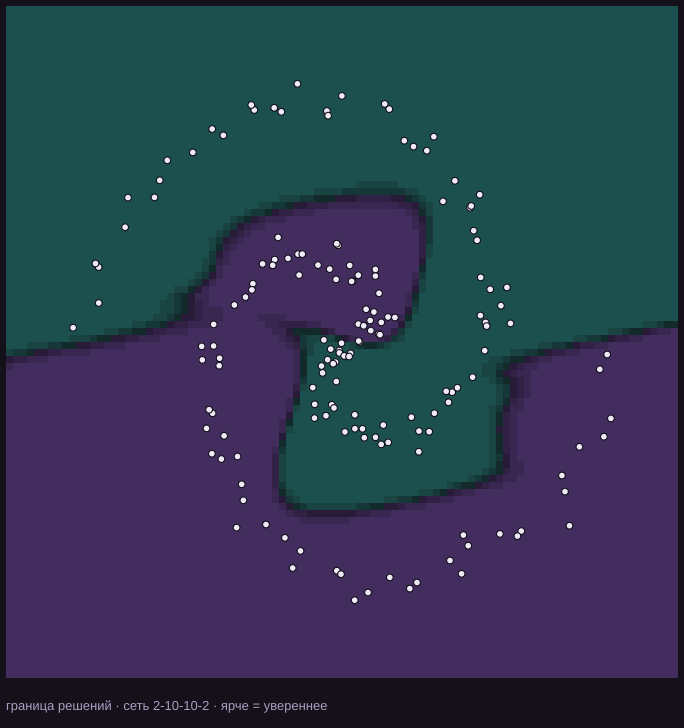
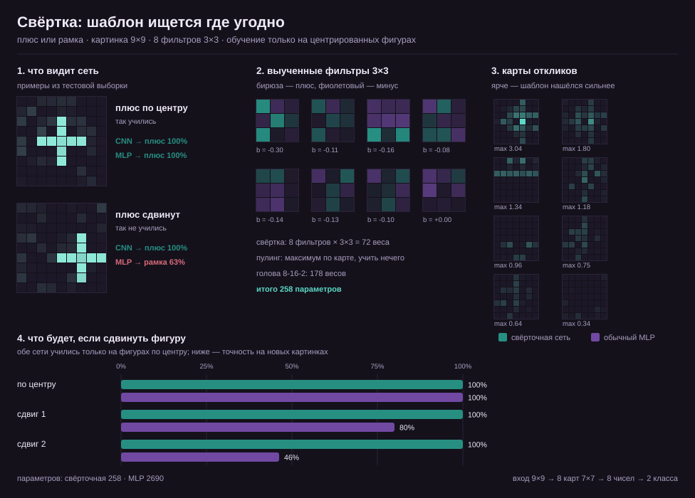

# AI Project

> 🤖 Проект создан с помощью ИИ.

Нейросеть с нуля на чистом Python: **без numpy, без torch, без единой зависимости**. Только списки, математика и обратное распространение ошибки.

Сначала — две переплетённые спирали и граница решений. Потом — картинки: свёрточная сеть учится отличать плюс от рамки в любом месте кадра, хотя видела фигуры только по центру.





## Результат

### Спирали

```
точек: 160   сеть: 2-10-10-2   эпох: 300
эпоха   50   потеря 0.3850   точность 83.1%
эпоха  100   потеря 0.2194   точность 90.6%
эпоха  300   потеря 0.0123   точность 99.4%

точность на обучающих данных: 99.4%
время: 2.6 с   параметров: 162
```

### Плюс или рамка

```
картинок: 160   фильтров: 8   CNN 60 эпох, MLP 100 эпох

                 параметры    центр   сдвиг 1   сдвиг 2
свёрточная             258   100.0%    100.0%    100.0%
MLP                   2690   100.0%     80.0%     46.2%
```

Обе сети учились **только на центрированных фигурах**. Сдвиг на одну-две клетки ломает MLP: он запомнил пиксели по местам. Свёртка ищет шаблон 3×3 по всей картинке, а глобальный максимум выбирает лучший отклик — поэтому ей почти всё равно, где нашлась фигура. И параметров у неё в десять раз меньше.

## Запуск

```bash
python train.py                  # спирали, 300 эпох
python train.py --epochs 800     # точнее, но дольше
python train.py --hidden 16      # шире скрытый слой

python conv_demo.py              # свёрточная сеть против MLP на картинках
python conv_demo.py --epochs 100 --epochs-mlp 200
```

`train.py` печатает потерю и точность каждые 50 эпох, а в конце перерисовывает `docs/boundary.svg`. `conv_demo.py` обучает две модели, печатает таблицу точности на сдвигах и собирает `docs/conv.svg` с фильтрами, картами откликов и диаграммой.

## Тесты

```bash
python -m unittest discover -s tests
```

29 тестов. Главные — **сверки градиента**: аналитический backward сравнивается с численной производной по каждому весу. Для полносвязного слоя это первый слой MLP, для свёртки — все веса 3×3-фильтров. Если формула обратного распространения сломается, тест это покажет с точностью до пятого знака. Отдельно проверяется, что глобальный максимум не замечает сдвига фигуры.

## Как это устроено

Всего четыре файла — и ни одного фреймворка.

**`nn.py` — сеть**

- `Dense` — слой `y = activation(W·x + b)`: веса, смещения, прямой проход и ручной `backward`, который считает `dL/dW` и `dL/dx`;
- `MLP` — цепочка слоёв, проход вперёд и назад по очереди;
- `Conv2D` — фильтр 3×3 скользит по картинке и даёт карту откликов. Весов у него `фильтры · каналы · k · k`, а не «вход × выход»: один шаблон проверяет всё изображение. Backward считает градиенты фильтра и входной картинки;
- `GlobalMaxPool` — берёт из каждой карты один максимум и запоминает, где он был, чтобы вернуть градиент ровно в эту клетку;
- `ConvNet` — свёртка → пулинг → обычная полносвязная «голова»;
- `softmax` + перекрёстная энтропия — функция потерь. Её градиент по логитам равен «вероятности минус one-hot», поэтому весь backward получается коротким.

**`datasets.py` — данные**

Две спирали генерируются формулой `x = r·cos θ`, `y = r·sin θ`, вторая — поворотом на 180°. Картинки `shapes` — плюс и рамка на сетке 9×9: фигуру можно сдвинуть от центра и добавить шума по яркости. Ничего не скачивается, всё воспроизводимо по seed.

**`train.py` — обучение на спиралях**

SGD по мини-батчам, а в конце — сетка 96×96: в каждой точке спрашиваем у сети вероятность классов и красим клетку. Соседние одинаковые клетки склеиваются в один прямоугольник, иначе SVG весил бы сотни килобайт.

**`conv_demo.py` — обучение на картинках**

Строит CNN и MLP, обучает обе на одних данных, считает точность на сдвигах и рисует SVG: примеры, выученные фильтры, карты откликов и столбики точности. Картинки остаются вложенными списками, батч — просто цикл; отдельного тензора нет.

## Что здесь нарочно не сделано

- нет GPU и матричных библиотек — на сотнях параметров это не нужно;
- нет Adam, dropout и нормализации — они прячут суть, а задача показать суть;
- свёртка только `valid`, с шагом 1 и без padding: фигура должна целиком помещаться в кадр. Для 9×9 этого хватает, а код остаётся читаемым;
- нет strides, dilation и многоканальных входов — это следующие шаги, если понадобятся.

## Почему это полезно

Пока пишешь это руками, становится видно, откуда берётся «магия» обучения: градиент — это просто производная, шаг — просто вычитание, а «нейросеть учится» — это уменьшение числа на экране. Свёртка добавляет второй важный трюк: один и тот же маленький шаблон применяется ко всем клеткам картинки. Когда после этого садишься за PyTorch, там уже нет ничего загадочного.
